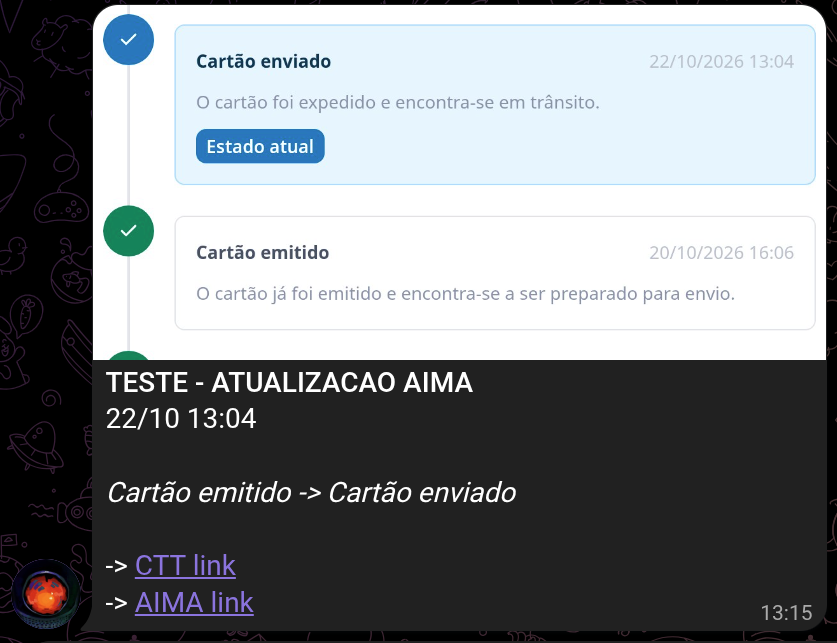

# aima-cron-job

Watches your AIMA residence card request (the `contactenos.aima.gov.pt/tracking/...` page) and sends a Telegram
message with a screenshot when the status changes. It runs a few times a day on any Linux box, for example a
Raspberry Pi.



## Setup

1. Clone the repo and install:

   ```bash
   git clone https://github.com/victor-schumann/aima-cron-job.git ~/aima-cron-job
   cd ~/aima-cron-job
   python3 -m venv venv
   venv/bin/pip install -r requirements.txt
   venv/bin/playwright install --with-deps --only-shell chromium
   ```

   `--with-deps` runs `sudo apt` and may upgrade system packages; the browser takes about 275 MB.
2. Create a Telegram bot with @BotFather, add it to your chat, and copy `.env.example` to `.env`.
   Fill in your tracking id (the last part of your AIMA tracking link), the bot token and the chat id.
3. Test it: `set -a; . ./.env; set +a; venv/bin/python aima_watch.py --test` sends a "TESTE" message with
   the current status.
4. Run it once without `--test` to save the current status, then schedule it with the units in
   `systemd/` (see TECHNICAL_SETUP.md step 8) or with cron (replace `~/aima-cron-job` if the repo is elsewhere):

   ```
   0 8,14,16,20 * * * cd ~/aima-cron-job && set -a && . ./.env && venv/bin/python aima_watch.py
   ```

Full details and troubleshooting: [TECHNICAL_SETUP.md](TECHNICAL_SETUP.md). If you use an AI assistant to set it
up, point it to that file.
